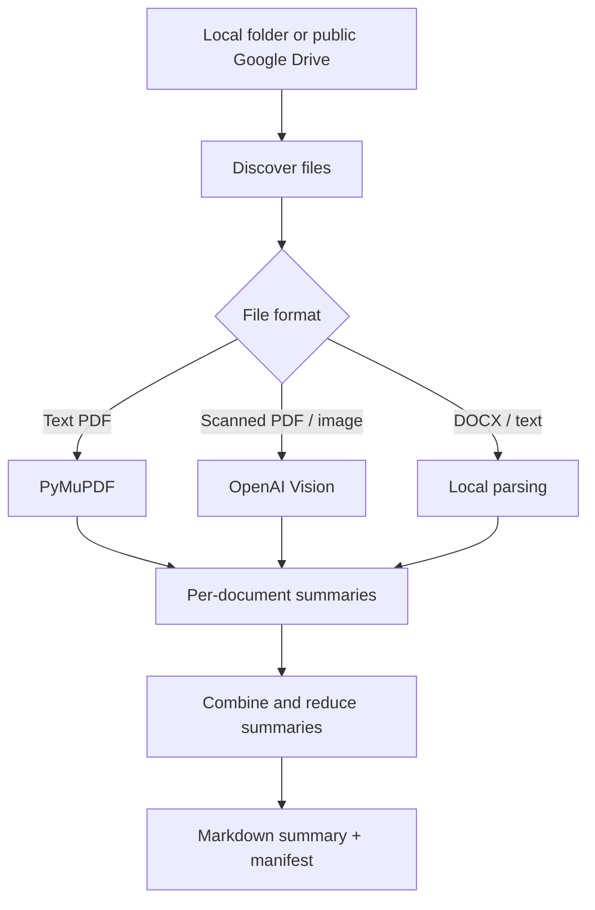

# AI Document Summarizer · Трибониан AI

Тестовое задание на позицию **AI Automation Engineer**: Python CLI, объединяющая содержимое папки с юридическими документами в единое русскоязычное саммари, с указанием источников и неполных фрагментов.

> **Статус проверки:** офлайн-проверки, unit tests и локальное извлечение текста из PDF выполнены. Полный вызов OpenAI API в этой среде **не запускался** (не был предоставлен API-ключ). `example/sample_summary.md` — подготовленный и сверенный вручную пример результата, не выдаваемый за результат API-вызова.

## Поддержка форматов

| Вход | Обработка |
| --- | --- |
| PDF с текстовым слоем | извлечение через PyMuPDF, постраничные источники |
| PDF-сканы | рендер страниц + OpenAI Vision |
| JPEG / PNG / WEBP | анализ через OpenAI Vision |
| DOCX | абзацы и таблицы через python-docx |
| TXT / Markdown | UTF-8, в том числе BOM |

Программа рекурсивно обходит подпапки и сохраняет `results/manifest.json`, `results/extracted/*.txt` и, при полноценном запуске, `results/summary.md`. Если какой-либо файл не удалось обработать, ошибка фиксируется, а саммари не изображает полный охват.

## Архитектура



## Установка

Требуется **Python 3.10+** и `OPENAI_API_KEY` для AI-режима. Подписка ChatGPT не включает OpenAI API.

```powershell
py -m venv .venv
.venv\Scripts\Activate.ps1
py -m pip install -r requirements.txt
$env:OPENAI_API_KEY = "YOUR_API_KEY"
```

Для Linux/macOS:

```bash
python3 -m venv .venv
source .venv/bin/activate
python -m pip install -r requirements.txt
export OPENAI_API_KEY="YOUR_API_KEY"
```

### Локальная папка

```bash
python summarize_folder.py --input ./input --output ./results
```

### Открытая папка Google Drive

```bash
python summarize_folder.py --drive-url "https://drive.google.com/drive/folders/1x6EKNkVw6PlFVTr6cGrsVscmRuwqGrXd" --output ./results
```

Этот способ использует `gdown` и работает только если Google разрешает публичное скачивание папки. Если загрузка заблокирована, скачайте папку вручную и используйте `--input`. Для частного Google Drive в production понадобятся OAuth 2.0/Drive API.

### Проверка без API (dry run)

```bash
python summarize_folder.py --input ./demo_input --output ./check_results --check
```

В режиме `--check` изображения отмечаются `needs_vision`, полноценное AI-саммари **не создаётся**.

## Тестирование

```bash
python -m pip install -r requirements-dev.txt
python -m pytest -q
```

Тесты используют синтетические документы и не обращаются к API. Они запускаются на GitHub Actions при push / pull request.

## Пример результата

В `example/sample_summary.md` приведено единое саммари трёх источников из тестовой папки: фото страницы ГрК РФ, фото страницы ГК РФ и двухстраничного PDF-фрагмента ГК РФ. Исходники доступны в [папке тестового задания](https://drive.google.com/drive/folders/1x6EKNkVw6PlFVTr6cGrsVscmRuwqGrXd). Они намеренно **не продублированы** в публичном репозитории.

## Безопасность и ограничения

- Не публикуйте API-ключи, клиентские документы, результаты распознавания и персональные данные: каталог `input/`, результаты и `.env` внесены в `.gitignore`.
- `store=False` используется при запросах к Responses API; при этом отправка данных третьей стороне должна быть согласована с требованиями конфиденциальности.
- В распознаваемых юридических документах возможны OCR-ошибки и галлюцинации модели. Требуется проверка человеком по первоисточнику.
- Программа не проверяет актуальность редакций законов и не даёт юридических заключений.
- Для production нужны OAuth, лимиты расходов, мониторинг, обработка больших папок и устойчивые повторы.

Лицензия проекта: MIT (см. `LICENSE`). Это демонстрационное тестовое, не готовый юридический продукт.